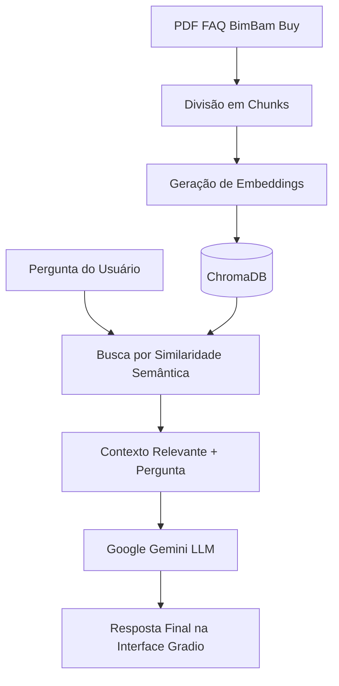
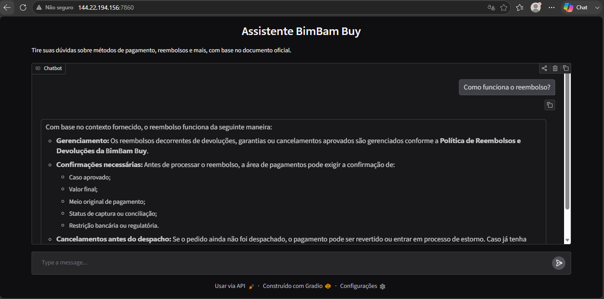

# 🤖 RAG BimBam Buy — Assistente de FAQ


Assistente de perguntas e respostas baseado em **RAG (Retrieval-Augmented Generation)**, construído sobre o documento de FAQ de métodos de pagamento da BimBam Buy. O sistema busca os trechos mais relevantes do documento e usa o modelo Google Gemini para gerar respostas contextualizadas e precisas, eliminando alucinações e garantindo que as respostas fiquem restritas à base de conhecimento da empresa.

---

<!-- Insira aqui um print ou GIF da sua interface rodando no Gradio -->
<!--  -->

## 💡 Como Funciona



1. **Processamento do Documento:** O PDF do FAQ é carregado e particionado em pedaços menores (chunks).
2. **Vetorização:** Cada chunk é convertido em um vetor numérico (embedding semântico) via `gemini-embedding-001`.
3. **Armazenamento:** Os vetores são indexados no banco de dados vetorial local **ChromaDB**.
4. **Recuperação (Retrieval):** Ao receber uma dúvida do usuário, o sistema recupera os vetores mais próximos no banco.
5. **Geração (Augmentation):** Os trechos resgatados servem de contexto único para que o modelo **Gemini** elabore a resposta final.
6. **Interface:** Comunicação via chat interativo web usando **Gradio**.

---

## 🛠️ Tecnologias Utilizadas

* **Orquestração:** [LangChain](https://www.langchain.com/)
* **LLM:** Google Gemini (`gemini-3.6`)
* **Embeddings:** Google Generative AI Embeddings (`gemini-embedding-001`)
* **Vector Store:** [ChromaDB](https://www.trychroma.com/)
* **Interface Web:** [Gradio](https://www.gradio.app/)
* **Parsing de Documentos:** PyPDF

---

## 🚀 Como Executar o Projeto

### Pré-requisitos
* Python 3.10 ou superior
* Uma API Key gratuita do Google Gemini (obtenha no [Google AI Studio](https://aistudio.google.com/apikey))

### Passos

1. **Clonar o repositório:**
   ```bash
   git clone https://github.com/SEU_USUARIO/rag-bimbam-buy.git
   cd rag-bimbam-buy
   ```

2. **Instalar dependências:**
   ```bash
   pip install -r requirements.txt
   ```

3. **Configurar a chave de API:**
   * **Linux/macOS:**
     ```bash
     export GOOGLE_API_KEY="sua_chave_aqui"
     ```
   * **Windows (Command Prompt):**
     ```cmd
     set GOOGLE_API_KEY=sua_chave_aqui
     ```
   * **Google Colab:**
     Adicione a chave no menu lateral em **Secrets** 🔑 com o nome `GOOGLE_API_KEY`.

4. **Documento de entrada:**
   Certifique-se de que o arquivo PDF do FAQ esteja salvo no diretório raiz do projeto ou ajuste o caminho indicado no notebook.

5. **Iniciar a aplicação:**
   Abra o notebook (`Agente_IA_BimBam_Buy.ipynb`) no seu ambiente de preferência ou rode o python app.py no terminal e execute as células. Ao final, o link da interface do Gradio será exibido no console.

---

## 📂 Estrutura do Repositório

```text
rag-bimbam-buy/
├── .gitignore
├── README.md
├── requirements.txt
├── faq-bimbam-buy.pdf    # Arquivo de dados de contexto
└── notebook.ipynb        # Pipeline completo de RAG
```

---

## 🛡️ Segurança

* **Nunca insira sua chave API diretamente no código**. Use sempre variáveis de ambiente ou ferramentas de gerenciamento de segredos.
* O arquivo `.gitignore` do repositório já está pré-configurado para ignorar arquivos de configuração locais e ambientes virtuais (`.env`, `venv/`, `.chroma/`).

---

## 📌 Próximos Passos (Roadmap)

- [x] Implantação em produção (Oracle Cloud Infrastructure / OCI)
- [ ] Implementação de memória de histórico de conversas (Multi-turn chat)
- [ ] Suporte a múltiplos arquivos/formatos de documentos
- [ ] Aprimoramento da interface gráfica

---

💬 Exemplos de Uso

Pergunta: Quais métodos de pagamento estão disponíveis?

Resposta do agente:

Com base no contexto fornecido, a BimBam Buy pode aceitar os seguintes métodos de pagamento (cuja disponibilidade pode variar por país, categoria, valor e configuração operacional):

Cartão de crédito
Cartão de débito
Transferência bancária / PIX
Pagamento em dinheiro em pontos habilitados (ex: Boleto)
Carteiras digitais disponíveis por país
Parcelamento ou financiamento, quando aplicável

Pergunta 2: Como funciona o reembolso?

Resposta do agente:

Com base no contexto fornecido, o reembolso funciona da seguinte maneira:

Gerenciamento: Os reembolsos decorrentes de devoluções, garantias ou cancelamentos aprovados são gerenciados conforme a Política de Reembolsos e Devoluções da BimBam Buy.
Confirmações necessárias: Antes de processar o reembolso, a área de pagamentos pode exigir a confirmação de:
Caso aprovado;
Valor final;
Meio original de pagamento;
Status de captura ou conciliação;
Restrição bancária ou regulatória.
Cancelamentos antes do despacho: Se o pedido ainda não foi despachado, o pagamento pode ser revertido ou entrar em processo de estorno. Caso já tenha saído para distribuição, aplicam-se as regras de pós-venda e logística.

---

🌐 Deploy em Produção

A aplicação está implantada e em funcionamento em uma instância gratuita (Always Free) da Oracle Cloud Infrastructure (OCI).

🔗 Acesse a aplicação: http://144.22.194.156:7860

 
 